# Heirloom

**Stories worth handing down.** Heirloom gently asks the people you love one question a week about their life. They answer by typing, by talking, or with a photo, and the family ends up with a library of their stories, a family tree, a website that works from a USB stick, and a real printed book.

It's self-hosted (your server, your data) and designed first for storytellers aged 70 to 90+, most of them on an iPad.

<p align="center">
  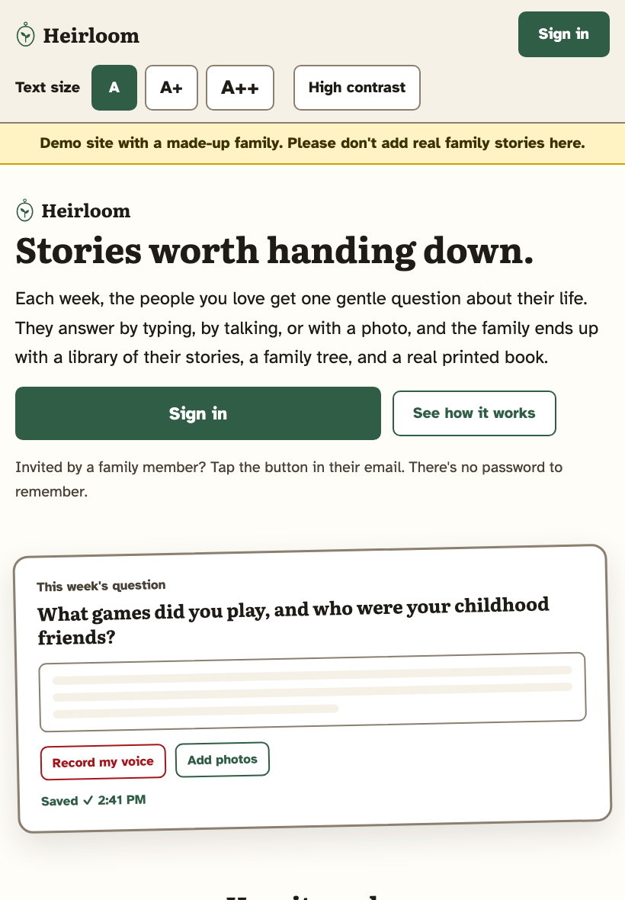
  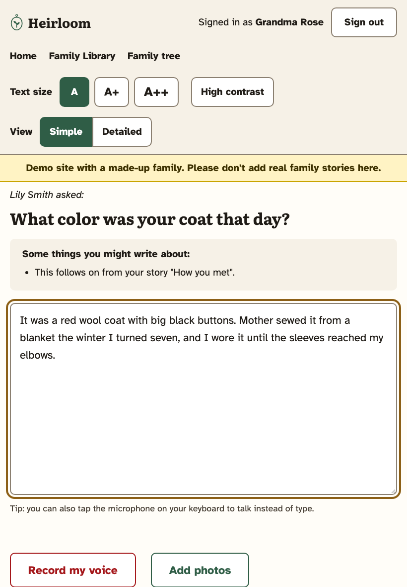
  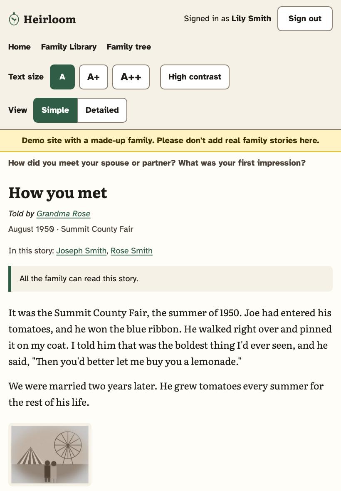
</p>

<sub>All screenshots are from demo mode on an iPad-sized screen. The family (Grandma Rose, her son David, her daughter Ann and her granddaughter Lily), their stories and their "old photos" are all made up.</sub>

## What it does

- **One question per screen.** Large text (A / A+ / A++ and high contrast), big buttons with words, autosave every 5 seconds, **Skip for now** and **I'd rather not answer**. A "Need help?" phone number is on every page.
- **No passwords.** People sign in by tapping a link in an email, or by scanning a printed QR login card; then the iPad remembers them.
- **52 thoughtful questions** in 12 chapters (Core 26 or all 52), paced one a week. Family members can ask follow-up questions ("Lily asked: …").
- **Answer your way:** type, record your voice (also turned into AAC audio files that play everywhere), add photos (iPhone HEIC is fine) and documents. Grandchildren can sit beside Grandma and write it down for her ("Told by Rose · written by Lily").
- **Gentle reminder emails** with the question and one big button, on a schedule that survives daylight-saving changes, with snooze and stop links. Admins get a nudge if someone goes quiet.
- **Sharing you control:** each story can be for all the family, certain people, only you, or anyone with a special link (optional passcode and expiry). Admins can always see everything, and every picker says so.
- **Family Library:** newest stories, chapters, storytellers, a timeline, photos, search, ♥ and notes.
- **Family tree** with person pages ("Stories told by them", "Stories about them", "Photos they appear in"), photo tagging, and GEDCOM import and export.
- **Exports:**
  - a family website (zip) that works offline from a USB stick;
  - a shareable PDF;
  - a **print-ready book package** for Lulu, Amazon KDP or a local printer: interior and cover PDFs with a calculated spine width, EPUB, DOCX, Markdown sources and a preflight report;
  - a complete archive in open formats.
- **Backups:** encrypted with restic every night, checked every week, restorable from the admin page, plus a disaster-restore script for a new server.
- **Status page and API:** `/status` says in plain words whether each part is working; `/api/status` gives monitors JSON (and a 503 when something breaks). `/healthz` and `/readyz` are there for container health checks.
- **Simple or Detailed view, on every page:** **Simple** (the default) keeps the large, calm look; **Detailed** adds a sidebar with every section, compact tables and, for admins, a dashboard. Each person's choice is remembered.
- **Optional extras**, off by default: local speech-to-text (Whisper), answering by replying to the email, and printable paper question packets.

## A look around

### For storytellers
One question at a time, in large type, with a "Need help?" phone number on every page.

| Home | Answering a question | Signing in |
|---|---|---|
| 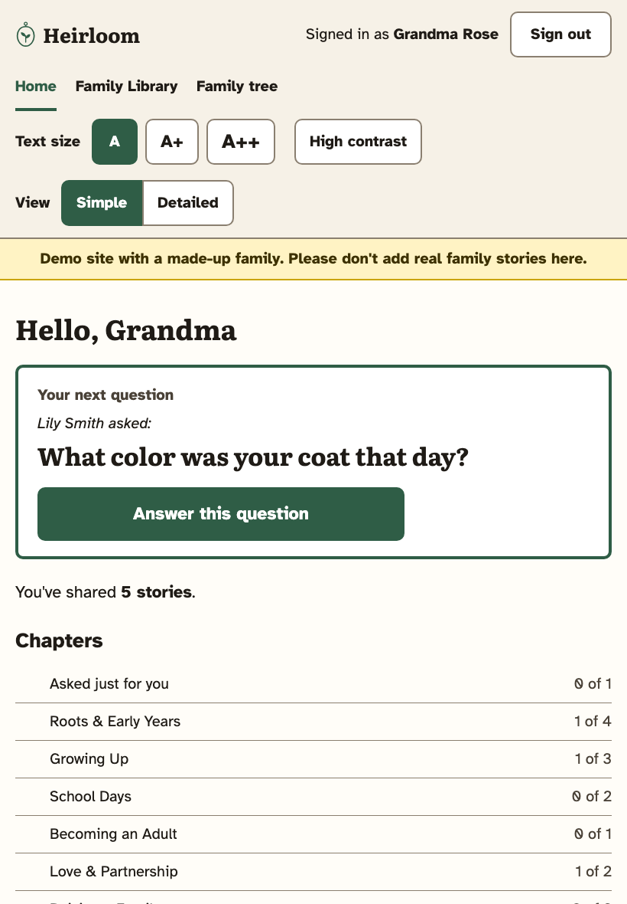 |  | 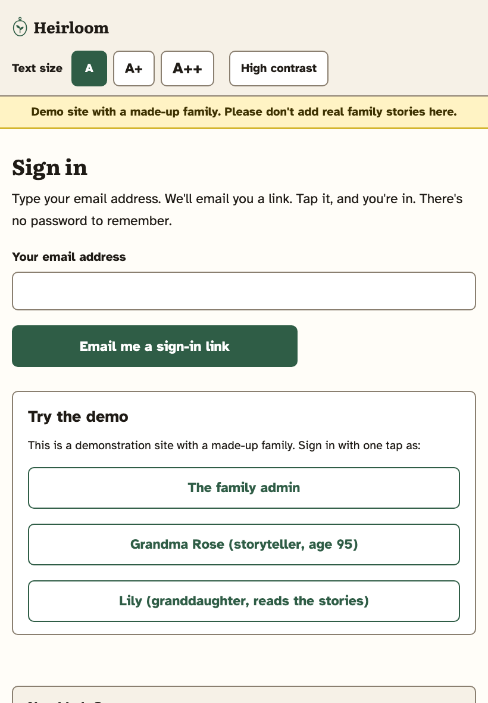 |

### For the family
Read the stories, leave a ♥ or a note, ask a follow-up question, and explore photos and the family tree.

| Family Library | A story | Photos |
|---|---|---|
| 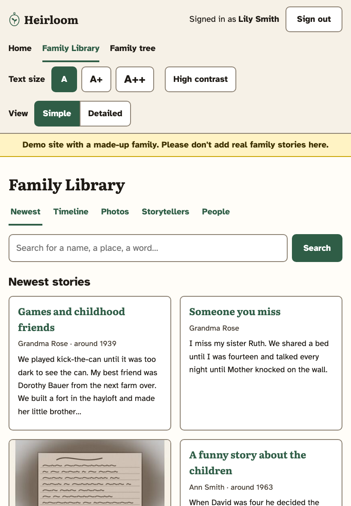 |  | 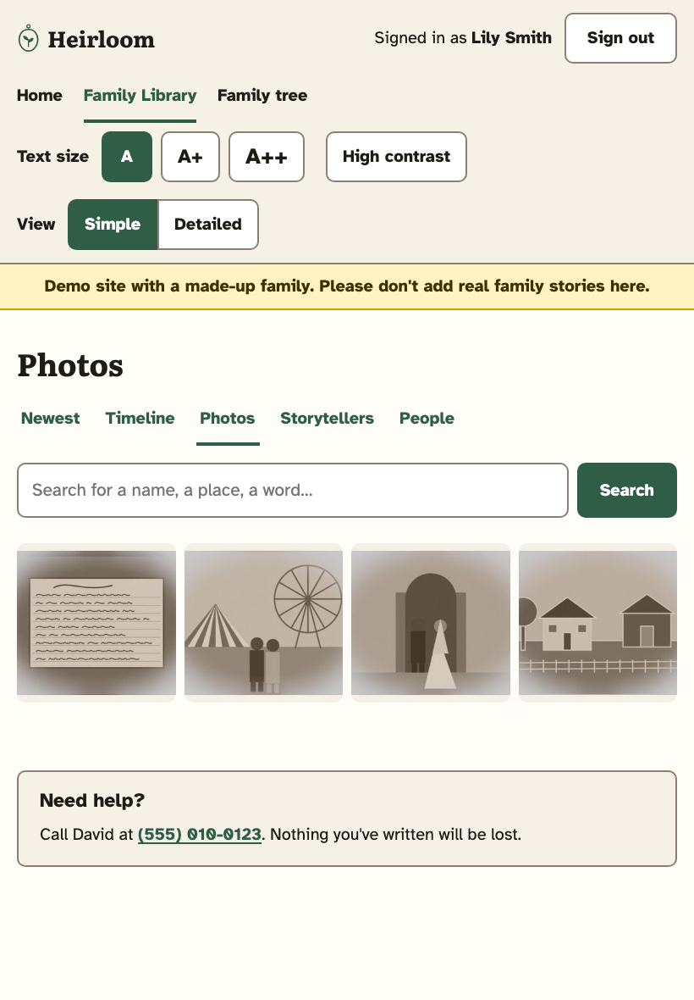 |

| Timeline | Family tree | Home |
|---|---|---|
| 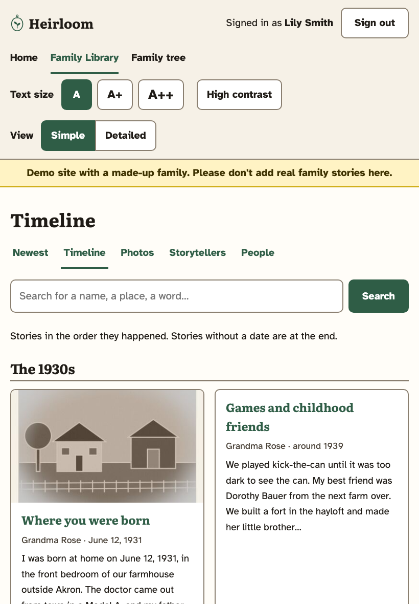 | 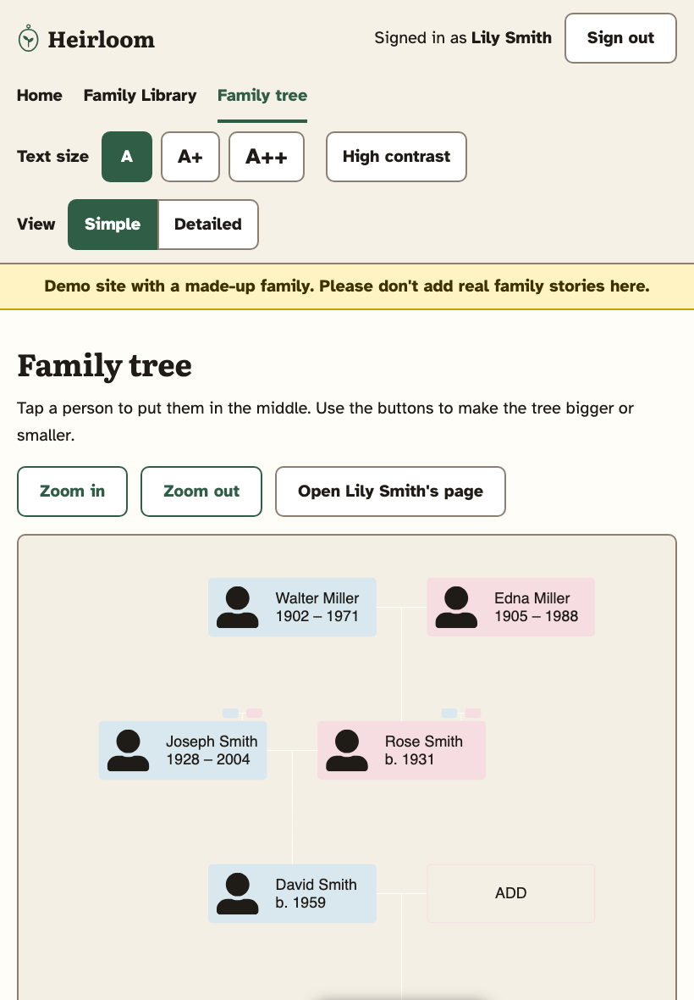 | 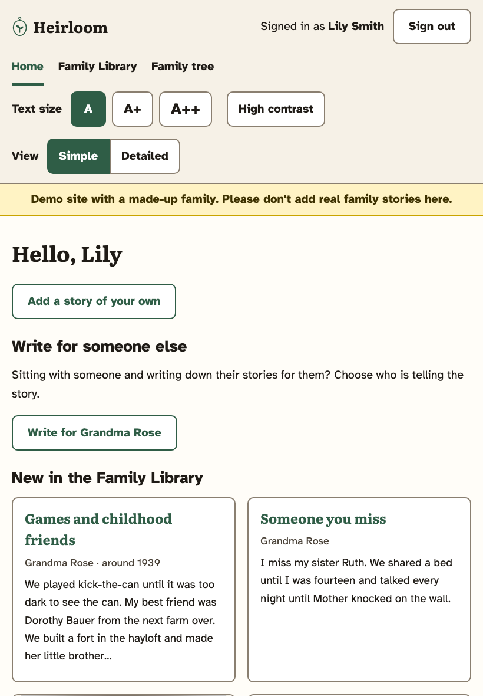 |

### For the family admin
Backups at a glance, people and invitations, and exports to a website, a PDF and a printed book.

| Admin home | People | Exports |
|---|---|---|
| 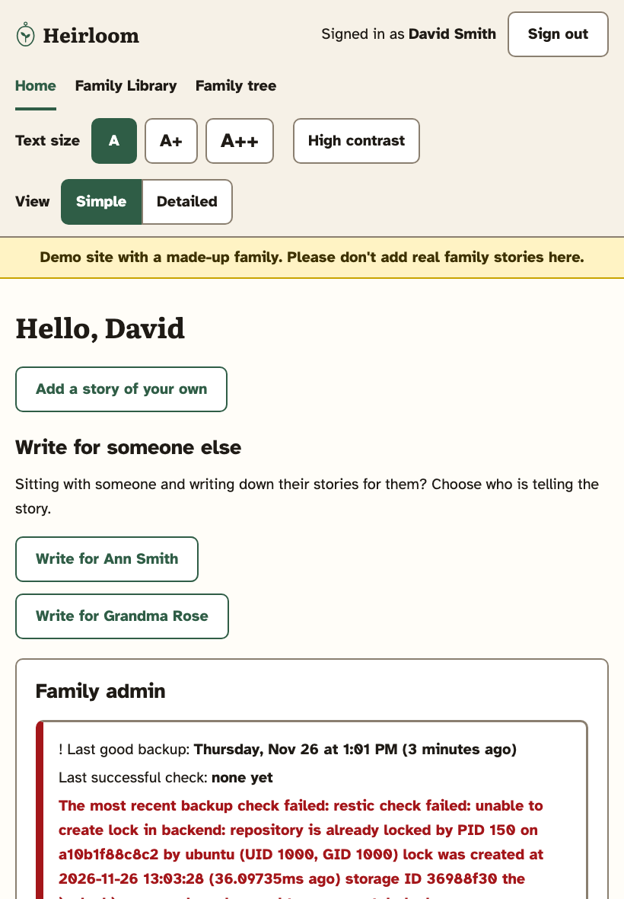 | 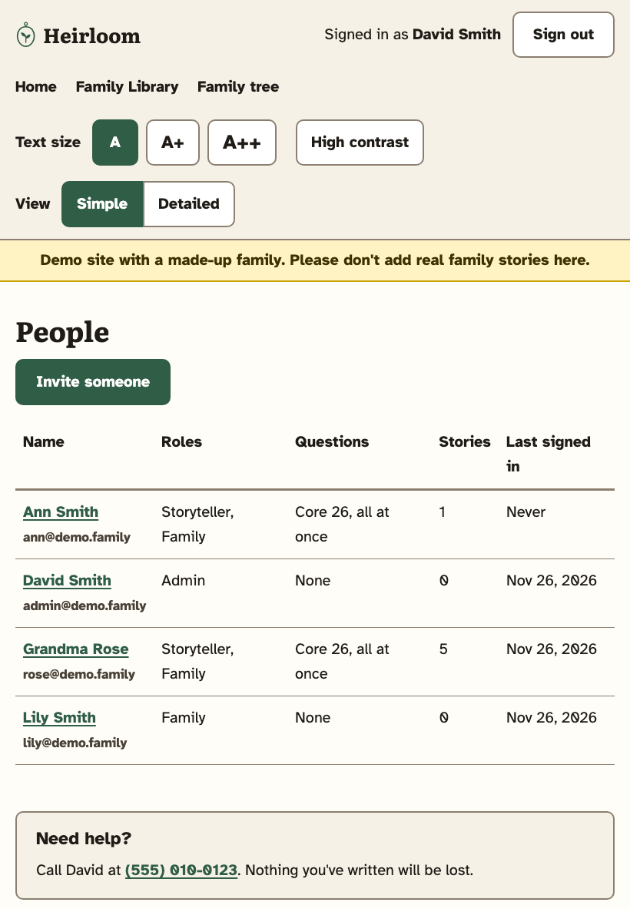 | 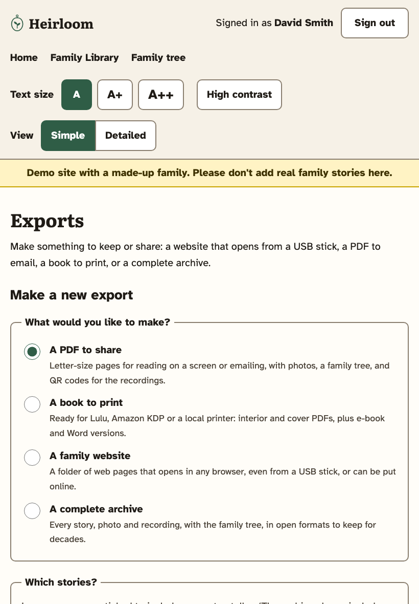 |

**Detailed view** (the **View: Simple | Detailed** switch is in the header on every page, and each person's choice is remembered):

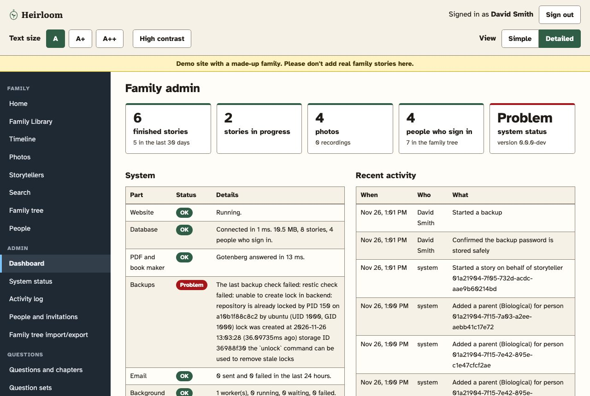

### Is everything working?
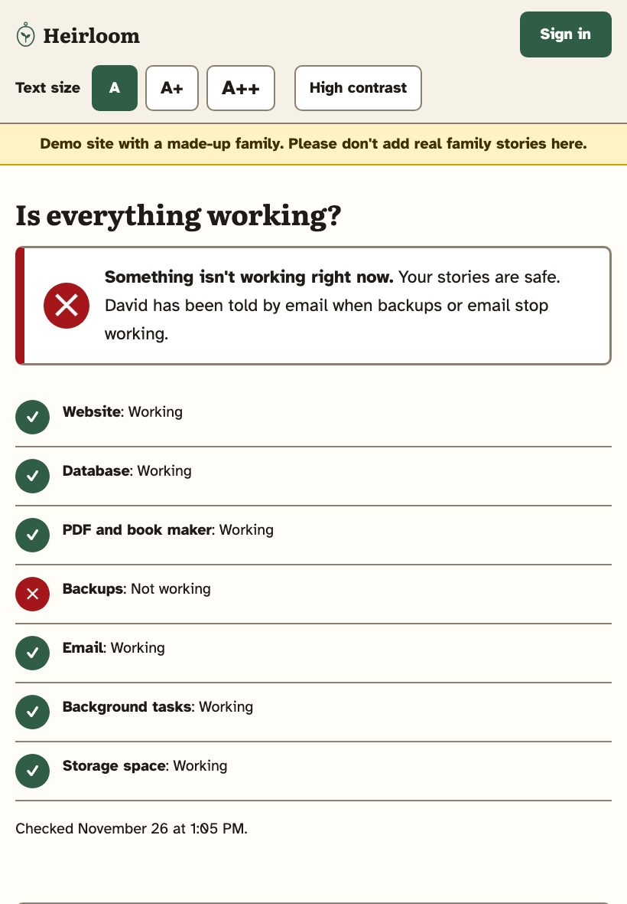

`/status` tells anyone, in plain words, whether each part is working; admins also see the details. Monitors use `/api/status` (JSON, 503 when something breaks; send `Authorization: Bearer $STATUS_TOKEN` for every component), and containers use `/healthz` and `/readyz`.

<br clear="right">

## Install (Docker Compose)

Every release publishes a multi-architecture image (amd64 for an Intel N100 server, arm64 too) and a ready-to-use compose file. See **[Releases](https://github.com/jmconlon2001/heirloom/releases)**.

```sh
mkdir -p /appdata/heirloom && cd /appdata/heirloom
# From the latest release: compose.yml (or heirloom.yml for OpenMediaVault) and env.example
cp env.example .env        # fill it in: PUBLIC_BASE_URL, ADMIN_EMAIL, POSTGRES_PASSWORD, SMTP_*, RESTIC_PASSWORD, DATA_ROOT, BACKUP_ROOT
docker compose pull && docker compose up -d
```

Then open `PUBLIC_BASE_URL`, type the `ADMIN_EMAIL` address, and tap the link in the email. The image is also published under its old name, `ghcr.io/jmconlon2001/family-memories`, so compose files from before the rename keep working.

- The app speaks plain HTTP on `APP_PORT` (default 8095) and expects a reverse proxy for HTTPS: **[docs/CADDY.md](docs/CADDY.md)**.
- OpenMediaVault: **[docs/DEPLOY_OMV.md](docs/DEPLOY_OMV.md)**. Proxmox (LXC or VM): **[docs/DEPLOY_PVE.md](docs/DEPLOY_PVE.md)**.
- Monitoring: `/api/status` (set `STATUS_TOKEN` for details), `/healthz`, `/readyz`. See [ADMIN_GUIDE.md](docs/ADMIN_GUIDE.md#is-everything-working).
- Running it day to day: **[docs/ADMIN_GUIDE.md](docs/ADMIN_GUIDE.md)**. Backups and disaster recovery: **[docs/RESTORE.md](docs/RESTORE.md)**.
- A one-page, large-type sheet to print for storytellers: **[docs/HELP_FOR_STORYTELLERS.pdf](docs/HELP_FOR_STORYTELLERS.pdf)**.

## Try it with a sample family (beta testing)

Set `DEMO_MODE=true` to get the made-up family from the screenshots (Grandma Rose's stories with old-looking photos, a four-generation tree, hearts, notes and a follow-up question) and one-tap sign-in buttons for **the family admin**, **Grandma Rose** and **Lily** on the sign-in page. Never use demo mode with real family stories. The reviewer walkthroughs are in **[docs/BETA_TESTING.md](docs/BETA_TESTING.md)**.

```sh
cp .env.example .env     # then set at least the values below
#   PUBLIC_BASE_URL=http://localhost:8095   DATA_ROOT=./.data/stack   BACKUP_ROOT=./.data/backups
#   ADMIN_EMAIL=admin@example.test   POSTGRES_PASSWORD=anything   DEMO_MODE=true
#   SMTP_HOST=mailpit   SMTP_PORT=1025   SMTP_SECURITY=None
docker compose --profile dev up -d
```

Open <http://localhost:8095>. Emails land in Mailpit at <http://localhost:8025>.

## Development

Requires the .NET 10 SDK, Docker (tests start PostgreSQL 17 and Gotenberg with Testcontainers), and `ffmpeg`, `restic`, `pandoc` and the PostgreSQL 17 client tools on your PATH (`PG_BIN_DIR` points at them if they're elsewhere).

```sh
dotnet build
dotnet test                                # 210+ tests: unit, integration (real PostgreSQL + Gotenberg), Playwright e2e with axe
dotnet tool restore && dotnet ef migrations add <Name> -p src/App -o Data/Migrations
docker compose --profile dev --profile proxy up -d --build && scripts/smoke-proxy.sh
```

| Folder | What |
|---|---|
| `src/App` | ASP.NET Core 10 Razor Pages app |
| `src/App/Templates/Export` | Shared templates for the website, PDF and book |
| `src/App.Tests` | xUnit v3 unit and integration tests |
| `src/App.E2E` | Playwright tests on iPad (WebKit) and desktop (Chromium), with axe accessibility checks |
| `seed/prompts.json` | The 52 questions and their hints |
| `docker/`, `Dockerfile`, `compose.yml` | Container image and stack |
| `scripts/` | Disaster restore, reverse-proxy smoke test |
| `docs/` | Build plan, decisions (ADRs), deployment and admin guides |

Every design decision is in **[docs/DECISIONS.md](docs/DECISIONS.md)**; what was built in each phase, and what's left, is in **[PROGRESS.md](PROGRESS.md)**.
